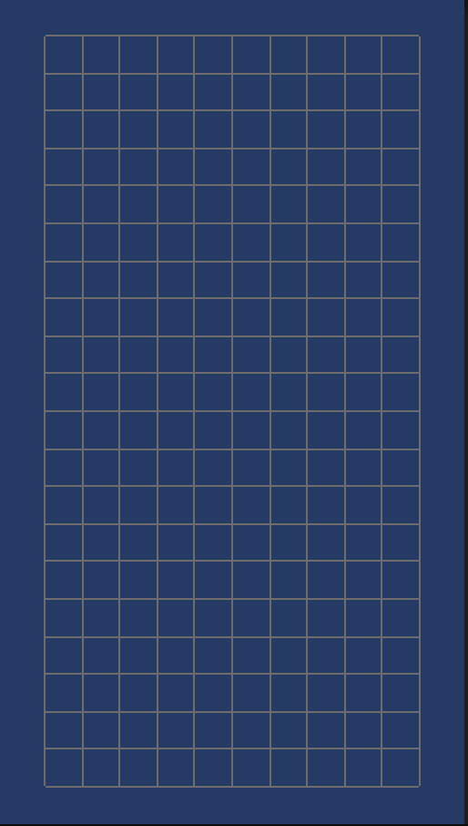

# BlockFall

## Project overview

BlockFall is an original learning project: a 2D falling-block game built with Unity and C#. The goal is to place falling pieces on a 10-by-20 board and clear completed rows. Development is at the visual playfield stage.

Unity is the game engine used to build and run the project. C# is the programming language used for its scripts. The project uses the Universal 2D setup with Universal Render Pipeline (URP), Unity's system for drawing the game on screen.

A free browser version on itch.io is planned for the future. There is no browser release available yet.

### Current prototype



*Current development stage: the 10×20 playfield. Gameplay is not yet implemented.*

## Motivation

This is a first game project for learning Unity, C#, game architecture, and Git. Game architecture means deciding how parts of the game share responsibilities. Git records changes so the developer can review the project's history.

The aim is to learn through small, testable steps and keep the code understandable as the game grows.

## Current status

The project currently displays an empty playfield:

- A 10-column, 20-row grid centered at world position `(0, 0)`.
- Cells measuring 1 Unity unit on each side. A Unity unit is a distance in the game world, not a screen pixel.
- Thin gray lines drawn with `SpriteRenderer`, visible in the Game view during Play Mode.
- An orthographic camera set up to show the full board, verified in Unity Game view at a portrait aspect ratio of **9:16**.

The development environment and GitHub repository are set up. The developer has checked the grid in Unity Play Mode, the Editor's way to run a scene without building a separate application.

Falling pieces, controls, scoring, and other gameplay mechanics are not implemented yet.

## Planned features

The intended direction is:

- Falling pieces with movement and rotation controls.
- Board boundary checks and piece placement, so pieces stay inside the board and stack on each other.
- Clearing completed rows, tracking a score, and handling game over and restart.
- A browser build and a free release on itch.io.

These are future goals. Their details and implementation order may change during development.

## Getting started

### 1. Install Unity

1. Download and install [Unity Hub](https://unity.com/download). It manages Unity Editor installations and projects.
2. Open the Hub and follow its account and license setup prompts.
3. Open **Installs > Install Editor** and install **Unity 6.6, version `6000.6.9f1`**. Use this exact version to match [ProjectVersion.txt](ProjectSettings/ProjectVersion.txt). If it is not listed, find it in the [Unity download archive](https://unity.com/releases/editor/archive) and choose its Hub installation option. See [Unity's installation instructions](https://docs.unity.com/en-us/hub/add-editor) for help.

You do not need a code editor or browser build tools to run the current scene in Play Mode.

### 2. Download the project

1. Open [Nikikikl/blockfall-unity](https://github.com/Nikikikl/blockfall-unity) on GitHub.
2. Select **Code > Download ZIP** and extract the archive.
3. Find the extracted project folder containing `Assets`, `Packages`, and `ProjectSettings`.

If you already use Git, you can clone the repository instead of downloading a ZIP:

```sh
git clone https://github.com/Nikikikl/blockfall-unity.git
```

### 3. Open the project

1. In Unity Hub, open **Projects > Add > Add project from disk**. These are the steps in [Unity's project management guide](https://docs.unity.com/en-us/hub/project-manage).
2. Select the project root folder from the previous step, not the `Assets` folder inside it.
3. Open the project with `6000.6.9f1`.
4. Wait for Unity to import the assets, download the project's packages, and compile the scripts. Keep an internet connection available for the first import.

Open this existing project; there is no need to create another project from a template.

### 4. Run the scene

1. In the Unity Editor's **Project** window, the file browser for the project, open **Assets > Scenes**.
2. Double-click [SampleScene.unity](Assets/Scenes/SampleScene.unity). A scene is a saved arrangement of objects, including the camera and the board.
3. Open the **Game** tab. If it is hidden, choose **Window > General > Game**.
4. Open the Game view's aspect ratio dropdown and choose **Portrait 9:16**, the format used to check the full board. This sets the preview's width-to-height ratio.
5. If that option is missing, choose **Add** (the **+** button) in the dropdown. Set **Type: Aspect Ratio**, **Width: 9**, and **Height: 16**. Enter **Portrait 9:16** as the label, confirm with **OK**, and select the new entry.
6. Click the **Play** button at the top of the Editor.

This is an Editor preview setting. A custom aspect ratio added on one computer may be missing on another; add it there using the same steps if needed.

You should see a gray 10-by-20 grid on a blue background, with the full board in view. The scene already contains the `BoardGrid` component; you do not need to add it again. Nothing falls or responds to input at this stage.

Click **Play** again to stop. To check for errors, open **Window > General > Console**; the expected result is no error messages from `BoardGrid`.

## Project structure

```text
blockfall-unity/
├── Assets/
│   ├── Scenes/          Main scene: SampleScene.unity
│   ├── Scripts/         Game scripts: BoardGrid.cs
│   ├── Settings/        Rendering, input, and scene template assets
│   └── Welcome/         Welcome content from the Unity 2D template
├── docs/images/
│   └── board-grid.png   Current prototype screenshot
├── Packages/            Unity package list and locked package versions
├── ProjectSettings/     Unity version and project settings
├── .agents/             Local Ponytail skill for coding assistance
├── .gitignore           Files Git should leave out
├── AGENTS.md            Project instructions for coding assistants
└── README.md            Project overview and setup instructions
```

[Packages/manifest.json](Packages/manifest.json) lists the packages the project uses. The [.gitignore](.gitignore) excludes generated folders such as `Library`, `Temp`, and `Logs`; Unity recreates these when needed.

Keep `.meta` files with their associated assets. Unity stores asset identifiers in these files and uses them to keep references between scenes, scripts, and other resources.

## How it works

### BoardGrid and SpriteRenderer

[BoardGrid.cs](Assets/Scripts/BoardGrid.cs) is a component attached to the `BoardGrid` object in the main scene. A GameObject is Unity's container for an item in a scene; components give it behavior or a visual appearance.

When Play Mode starts, Unity calls the script's `Start()` method. The script creates one white sprite, a 2D image, and shares it across 32 line objects. Each object has a `SpriteRenderer`, the component that draws a sprite in the game. The script stretches the sprite into a thin rectangle and colors it gray.

There are 11 vertical lines and 21 horizontal lines, including the outer edges. Their spacing creates 10 columns and 20 rows without creating 200 cell objects. The cells have no fill.

The line centers run from `-5` to `5` on X and from `-10` to `10` on Y. Line thickness is `0.05` Unity units. The board object has position and rotation set to zero and scale set to one, so the grid stays centered with 1-unit cells.

The lines appear when the scene runs. Stopping Play Mode removes those runtime objects. The grid is a visual guide; it does not yet store which cells contain blocks.

### Orthographic camera

An orthographic camera draws objects without perspective: their size does not shrink with distance from the camera. This suits a flat 2D board.

In [SampleScene.unity](Assets/Scenes/SampleScene.unity), the main camera sits at `(0, 0, -10)` and looks toward the board at `Z = 0`. Its orthographic Size is `11`, which means it shows 11 units above its center and 11 below it. That gives the 20-unit-tall board some space at the top and bottom. The visible width depends on the Game view's aspect ratio.

## Development roadmap

- [x] Create the Unity project and set up the development environment.
- [x] Connect the project to GitHub.
- [x] Draw a centered 10-by-20 grid using SpriteRenderer.
- [x] Improve grid line visibility.
- [x] Frame the full board with an orthographic camera.
- [x] Check the grid in Unity Play Mode.
- [ ] Static 2×2 square piece.
- [ ] Seven piece shapes.
- [ ] Random spawning.
- [ ] Automatic falling.
- [ ] Horizontal controls.
- [ ] Soft and hard drop.
- [ ] Rotation.
- [ ] Boundaries and collisions.
- [ ] Piece locking.
- [ ] Line clearing.
- [ ] Score, level and game over.
- [ ] Restart, pause and next-piece preview.
- [ ] Menu, audio, testing.
- [ ] Web build and itch.io release.

## Development workflow

Work on one small task at a time. Keep implementations readable and prefer built-in Unity and C# features over extra dependencies.

1. Check the existing code and decide what the task needs to change.
2. Make the smallest complete change for that task.
3. Check the code and test the affected behavior in the Unity Editor. For visual changes, check the Game view in Play Mode.
4. Review the Git diff, the list of file changes, and record each completed, verified milestone in its own commit. A commit is a saved checkpoint in Git's history.
5. Update this README when the setup instructions or project status change.

Use the Unity Project window when moving or renaming assets so Unity can preserve their references. Commit the corresponding `.meta` files alongside the assets, and keep generated folders out of Git.

See [AGENTS.md](AGENTS.md) for the project's instructions for coding assistants.

## Project limitations

- This is an early visual prototype, not a playable game. There are no falling pieces, controls, collision or placement rules, row clearing, scores, or game states yet.
- The grid dimensions, line thickness, and color are fixed in the script.
- The camera uses a fixed size. Very narrow aspect ratios can crop the sides of the board; automatic screen fitting is not implemented.
- The reported manual check covers the grid in Unity Play Mode. Browser builds and browser behavior still need validation before release.
