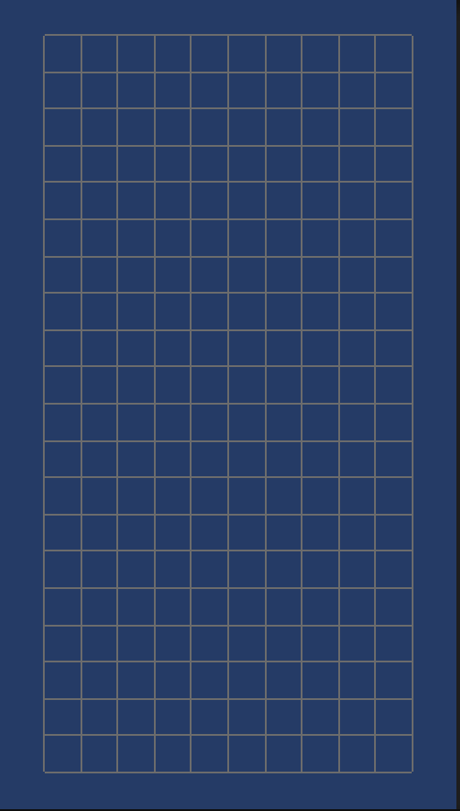

# BlockFall

## Project Overview

BlockFall is an original 2D falling-block game prototype built with Unity 6.6, C#, and Unity's Universal 2D rendering setup (URP). It is a first game project for learning Unity and building game systems in small steps. The goal is to place falling pieces on a 10×20 board and clear completed rows. A free browser release on itch.io is planned.

## Current Status

The scene creates a 10×20 grid and spawns one cyan 2×2 square at the top. You can move it sideways, speed up its fall, or drop it in one frame. The square locks when it can no longer move down, and the game records the four cells it occupies.

## Gameplay Screenshots



*Early playfield milestone. This Unity screenshot shows the grid before the square piece was added.*

## Development Milestones

1. Set up the Unity project and drew a centered 10×20 grid. An orthographic camera frames the full board in a portrait Game view.
2. Built the first 2×2 square from four cyan blocks.
3. Added left and right arrow controls and checked the side boundaries.
4. Added automatic falling, one cell at a time.
5. Added Soft Drop on Down Arrow and Hard Drop on Space.
6. Locked the piece on landing and disabled further movement.
7. Saved the square as `SquarePiece.prefab` and used `GameManager` to create it when the scene starts.
8. Added a record of occupied cells and checked each move against the board edges and those cells.
9. Moved creation into `SpawnPiece()` so a future game loop can reuse it. Today, only `Start()` calls it.

## Controls

Click inside the Game view in Play Mode before using the keyboard.

| Input | Action |
| --- | --- |
| Left Arrow / Right Arrow | Move one cell per press if the destination is clear. |
| Hold Down Arrow | Soft Drop. Try to fall one cell every 0.1 seconds. Release to restore the normal one-second interval. |
| Space | Hard Drop. Move to the lowest reachable row in one frame and lock the piece. |

## Project Structure

| Path | Purpose |
| --- | --- |
| [Assets/Scenes/SampleScene.unity](Assets/Scenes/SampleScene.unity) | Main scene with the camera, grid, and game manager. |
| [Assets/Prefabs/SquarePiece.prefab](Assets/Prefabs/SquarePiece.prefab) | Reusable square piece with four blocks and a movement component. |
| [Assets/Scripts/BoardGrid.cs](Assets/Scripts/BoardGrid.cs) | Draws the grid when the scene starts. |
| [Assets/Scripts/PieceMovement.cs](Assets/Scripts/PieceMovement.cs) | Reads keyboard input, checks moves, and locks the piece. |
| [Assets/Scripts/GameManager.cs](Assets/Scripts/GameManager.cs) | Spawns the first piece and records occupied cells. |
| [Assets/Settings/](Assets/Settings/) | Rendering, input, and scene template assets. |
| [Assets/Welcome/](Assets/Welcome/) | Welcome content from the Unity 2D template. |
| [Packages/](Packages/) | Unity package list and locked package versions. |
| [ProjectSettings/](ProjectSettings/) | Unity version and project settings. |
| [docs/images/](docs/images/) | Screenshots from the project's milestones. |

Keep `.meta` files with their assets. Unity uses the identifiers in them to find assets referenced by scenes and prefabs. See [AGENTS.md](AGENTS.md) for the project workflow.

## How It Works

**BoardGrid** draws 11 vertical and 21 horizontal lines using Unity's `SpriteRenderer`, which draws 2D images. The lines are one Unity unit apart. The board runs from X = −5 to 5 and Y = −10 to 10, with the lower-left cell at index `(0, 0)`.

**SquarePiece and PieceMovement.** A prefab is a saved object you can create copies of. This prefab groups four block objects under one parent so they move together. `PieceMovement` reads keys through the Unity Input System. Before moving, `CanMove()` works out the destination cell of each block and asks `GameManager.IsCellFree()` whether the cell is inside the board and empty. The piece locks when the step below it is blocked.

**GameManager** calls `SpawnPiece()` at startup to create the square at `(-1, 8, 0)`. The manager stores a 10×20 array named `occupiedCells`, with one true-or-false value per cell. When the piece locks, `WorldToCell()` maps each block's world position to a column and row. The manager marks all four cells as occupied, logs `Piece landed!` once, and clears its reference to the active piece.

## Getting Started

### 1. Install Unity

1. Download and install [Unity Hub](https://unity.com/download). It manages Unity Editor installations and projects.
2. Open the Hub and follow its account and license setup prompts.
3. Open **Installs > Install Editor** and install **Unity 6.6, version `6000.6.9f1`**. Use this exact version to match [ProjectVersion.txt](ProjectSettings/ProjectVersion.txt). If it is not listed, find it in the [Unity download archive](https://unity.com/releases/editor/archive) and choose its Hub installation option. See [Unity's installation instructions](https://docs.unity.com/en-us/hub/add-editor) for help.

You do not need a code editor or browser build tools to run the current scene in Play Mode.

### 2. Download the project

1. Open [Nikikikl/blockfall-unity](https://github.com/Nikikikl/blockfall-unity) on GitHub.
2. Select **Code > Download ZIP** and extract the archive.
3. Find the extracted project folder containing `Assets`, `Packages`, and `ProjectSettings`.

If you already use Git, you can clone the repository instead of downloading a ZIP:

```sh
git clone https://github.com/Nikikikl/blockfall-unity.git
```

### 3. Open the project

1. In Unity Hub, open **Projects > Add > Add project from disk**. These are the steps in [Unity's project management guide](https://docs.unity.com/en-us/hub/project-manage).
2. Select the project root folder from the previous step, not the `Assets` folder inside it.
3. Open the project with `6000.6.9f1`.
4. Wait for Unity to import the assets, download the project's packages, and compile the scripts. Keep an internet connection available for the first import.

Open this existing project; there is no need to create another project from a template.

### 4. Run the scene

1. In the Unity Editor's **Project** window, the file browser for the project, open **Assets > Scenes**.
2. Double-click [SampleScene.unity](Assets/Scenes/SampleScene.unity). A scene is a saved arrangement of objects, including the camera and the board.
3. Open the **Game** tab. If it is hidden, choose **Window > General > Game**.
4. Open the Game view's aspect ratio dropdown and choose **Portrait 9:16**, the format used to check the full board. This sets the preview's width-to-height ratio.
5. If that option is missing, choose **Add** (the **+** button) in the dropdown. Set **Type: Aspect Ratio**, **Width: 9**, and **Height: 16**. Enter **Portrait 9:16** as the label, confirm with **OK**, and select the new entry.
6. Click the **Play** button at the top of the Editor.

This is an Editor preview setting. A custom aspect ratio added on one computer may be missing on another; add it there using the same steps if needed.

A cyan square appears at the top of the board and starts falling. Click inside the **Game** view to give it keyboard focus, then try the controls above. Press **Space** to drop the piece to the bottom. It should stay in place, and the **Console** should show one `Piece landed!` message.

Click **Play** again to stop. To open the Console, choose **Window > General > Console**.

## Development Roadmap

- [x] Draw the grid and frame it with an orthographic camera.
- [x] Move the square and enforce the board boundaries.
- [x] Add automatic falling, Soft Drop, Hard Drop, and locking.
- [x] Spawn the initial square from a prefab and record its occupied cells.
- [x] Check moves against boundaries and occupied cells.
- [ ] Spawn the next piece on landing and test stacking in Play Mode.
- [ ] Add more piece shapes, random selection, and rotation.
- [ ] Clear full rows and add scoring, levels, and game over.
- [ ] Add restart, pause, a next-piece preview, menus, and audio.
- [ ] Build and test the browser version, then publish on itch.io.

## Known Limitations

- Each Play Mode run uses one square. Restart Play Mode to try another drop.
- The movement code checks occupied cells. Stacking and collisions between separate pieces still need Play Mode testing once the next piece can spawn.
- The camera has a fixed size, so a very narrow Game view can crop the board. A browser release is still planned.
